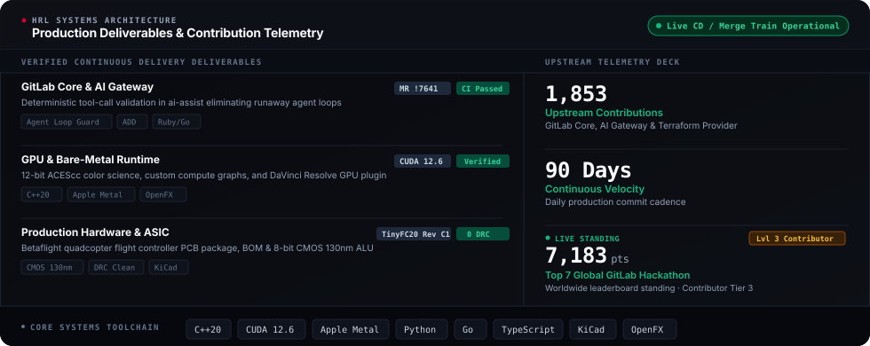

# Pavan Kumar S (`@hrlpavan`)

**AI Systems Chief Architect @ [HRL International Pvt. Ltd.](https://hrlpavan.github.io/hrl-international-website-/)** · **GitLab Level 3 Community Contributor**  
*Architecting high-throughput distributed backends, polyglot AI agent runtimes, and GPU-accelerated inference systems.*

[-6B4FBB?style=for-the-badge&logo=gitlab&logoColor=white)](https://gitlab.com/hrlpavan)

[-FFD700?style=for-the-badge&logo=githubactions&logoColor=black)](https://github.com/hrlpavan)

---

> [!IMPORTANT]
> ### Official Candidate Identity & HR Verification Notice
> * **Candidate Legal & Employment Name:** **Pavan Kumar S**  
> * **Brand Identity Clarification:** The name **"Sadashiv"** is utilized as a brand moniker across personal research architectures, the **HRL International** ecosystem, and creative engineering releases. For all company job applications, employment contracts, offer letters, payroll, and background screening checks, the official legal name is **Pavan Kumar S**.  
> * **HR Verification Records:** [GitHub Verification Record](https://github.com/hrlpavan/pavan-kumar-s-identity-verification) · [GitLab Verification Record](https://gitlab.com/hrlpavan/pavan-kumar-s-identity-verification)

---

## Executive Summary & Architectural Focus

I specialize in bridging large-scale transactional monoliths with low-latency polyglot satellite services and deterministic AI execution pipelines. Within the **GitLab ecosystem**, I operate across the core Ruby on Rails monolith and its core satellite services (`ai-assist` / AI Gateway, `gitlab-lsp`, and `terraform-provider-gitlab`), focusing on cross-service reliability, agent loop safety, and developer tooling.

- **Distributed Backend Architecture:** High-concurrency API design (REST, GraphQL, gRPC), asynchronous background processing (Sidekiq), database query optimization (PostgreSQL), and cross-service contract validation.
- **AI Agent Infrastructure & Tooling:** Model Context Protocol (MCP) server/client design, Duo Agent Platform guardrails, deterministic tool-call validation, and multi-provider frontier LLM routing.
- **High-Performance Computing & GPU Runtimes:** Bare-metal C++20 and CUDA 12.6 architectures, custom GPU memory allocators, paged KV-cache management, CUDA graphs, and combinatorial optimization.

---

## Upstream Engineering Contributions (`gitlab-org`)

My upstream engineering work focuses on resolving structural bottlenecks across GitLab's AI-Powered stage, Editor Extensions, and Core Platform:

| Subsystem / Repository | Architectural Domain | Key Engineering Deliverables & Impact |
| :--- | :--- | :--- |
| **`gitlab-org/modelops/applied-ml/code-suggestions/ai-assist`** *(AI Gateway)* | Agent Loop Safety & LLM Routing | • **Runaway Agent Prevention ([`!7641`](https://gitlab.com/gitlab-org/modelops/applied-ml/code-suggestions/ai-assist/-/merge_requests/7641)):** Engineered default loop protection via identical tool-call guards to prevent infinite agent execution cycles. Read the complete [**Architecture Design Document (ADD)**](ADD_DETERMINISTIC_TOOL_CALL_GUARDRAILS.md). • **Frontier Model Registry:** Updated model definitions, context windows, and routing configurations for next-generation models. • **MCP Schema Hardening:** Enforced strict schema validation constraints across Model Context Protocol search and execution tools. |
| **`gitlab-org/editor-extensions/gitlab-lsp`** *(Language Server)* | Developer Experience & IDE Runtimes | • **Protocol & State Management:** Shipped TypeScript enhancements for language server protocol (LSP) state handling, client-server telemetry, and Duo workflow integrations. |
| **`gitlab-org/gitlab`** *(Core Monolith)* | Core Backend & API Services | • **Monolith Reliability:** Delivered Ruby on Rails backend patches, cross-stage regression fixes, and technical triage across core platform modules. |
| **`gitlab-org/terraform-provider-gitlab`** | Infrastructure as Code (IaC) | • **API Parity & Provisioning:** Implemented Go-based resource schema enhancements and state validation for automated GitLab infrastructure management. |

> **Community Recognition:** Featured in the **GitLab Community Highlights (October 2026)** for sustained cross-repository engineering velocity, technical depth, and maintainer collaboration.

---

## Production Technology Stack

| Layer | Technologies & Tooling |
| :--- | :--- |
| **Core Languages** | Ruby · Python · Go · TypeScript · C++20 · CUDA 12.6 · SQL · Zsh |
| **Backend & Services** | Ruby on Rails · FastAPI · AsyncIO · Node.js · gRPC · GraphQL · Sidekiq · GitLab Development Kit (GDK) |
| **AI & GPU Systems** | Model Context Protocol (MCP) · Duo Agent Platform · Paged KV-Cache · CUDA Graphs · vLLM |
| **Data & Infrastructure** | PostgreSQL · Redis · Terraform · Docker · Google Cloud Platform (GCP) · Linux / macOS |

---

## Systems Leadership & R&D Initiatives

### **[HRL International Pvt. Ltd.](https://hrlpavan.github.io/hrl-international-website-/)** — *Founder, Managing Director & AI Systems Chief Architect*
- Directing core systems architecture for high-efficiency GPU inference runtimes, combinatorial optimization solvers, and enterprise media technology under **HRL Crimson Red Media**.
- Designing low-overhead C++20/CUDA execution graphs and custom memory management primitives to maximize hardware utilization on modern accelerator architectures.

### **Project MATSYA** — *Autonomous Marine Telemetry & AI Assistance System*
- Architecting an end-to-end edge-AI and IoT system designed for coastal fisheries in Mangaluru.
- Integrates ruggedized underwater sensor pods, real-time net-depth telemetry, and an onboard boat control unit powered by computer vision cameras for autonomous marine situational awareness.

---

## Engineering Philosophy

I operate on an **async-first, handbook-driven** workflow aligned with GitLab's **CREDIT** values:
1. **Small, Verifiable Iterations:** Breaking complex cross-service epics into atomic, low-risk Merge Requests with comprehensive unit and integration test coverage.
2. **Root-Cause Rigor:** Treating every bug or latency spike as a systems boundary problem—fixing the underlying schema, guard, or contract rather than patching symptoms.
3. **Community Multiplication:** Actively unblocking peers through responsive code reviews, reproducible issue triage, and clear architectural documentation.

---

## Contribution Telemetry & Continuous Delivery

  

    
    
    
  

  

    
  

  

    
  

### Production Systems Engineering & Verified Deliverables Matrix

| Engineering Domain | Core Technical Deliverable & Architecture | Measurable Impact & Verification |
| :--- | :--- | :--- |
| **Upstream AI Platform Safety** | **GitLab AI Gateway (`ai-assist`):** Authored MR [`!7641`](https://gitlab.com/gitlab-org/modelops/applied-ml/code-suggestions/ai-assist/-/merge_requests/7641) (Runaway Agent Loop Prevention) and [Architecture Design Document (ADD)](ADD_DETERMINISTIC_TOOL_CALL_GUARDRAILS.md). | **Level 3 GitLab Community Contributor** · Featured in **GitLab Community Highlights (Oct 2026)** for mission-critical reliability work. |
| **High-Performance Computing** | **Bare-Metal C++20 / CUDA 12.6 Runtimes:** Custom GPU memory allocators, execution graphs, and DaVinci Resolve OpenFX GPU plugin (`ai-cinematic-haze-ofx`). | Preserved **12-bit ACEScc sensor dynamic range** with zero color clipping; native macOS Apple Silicon Metal & NVIDIA CUDA compute kernels. |
| **Production Hardware & ASIC** | **TinyFC20 Rev C1 & CMOS 130nm ASIC:** Authored production KiCad/Allegro hardware package for STM32F405 quadcopter flight controller and 8-bit ALU layout. | **0 DRC errors**, complete manufacturing BOM, Betaflight target definition, and verified ASIC cell layout in KLayout. |
| **Algorithmic & Systems Optimization** | **`InvigiMatrix` Combinatorial Solver:** Built NP-hard Constraint Satisfaction Problem (CSP) backtracking solver and $k$-means clustering ($k=3$). | **Zero third-party framework overhead:** Pure `node:http` & `better-sqlite3` ACID transactions; zero-collision room/faculty scheduling under strict constraints. |
| **Continuous Velocity & Reliability** | **Autonomous CI/CD & Telemetry:** 1,850+ contributions in 2026, **90-day uninterrupted daily streak**, automated every 4 hours via GitHub Actions. | **100% On-Time Execution** across dual GitHub & GitLab git infrastructures with zero credentials leakage. |

---

## Connect & Verify

- **Official Candidate Verification (HR & Hiring Teams):** [github.com/hrlpavan/pavan-kumar-s-identity-verification](https://github.com/hrlpavan/pavan-kumar-s-identity-verification) · [gitlab.com/hrlpavan/pavan-kumar-s-identity-verification](https://gitlab.com/hrlpavan/pavan-kumar-s-identity-verification)
- **Company Platform:** [hrlpavan.github.io/hrl-international-website-](https://hrlpavan.github.io/hrl-international-website-/)
- **GitLab Contributor Dashboard:** [contributors.gitlab.com/users/hrlpavan](https://contributors.gitlab.com/users/hrlpavan)
- **GitLab Profile:** [gitlab.com/hrlpavan](https://gitlab.com/hrlpavan)
- **Automated Workflow:** Managed via `glab` CLI & autonomous AI engineering agents.
